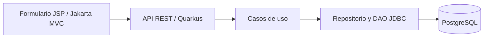

# Incident Tracker · Java

Aplicación académica de seguimiento de incidencias y registro de progresos. Proyecto de portfolio de Rodrigo Cabezas Pérez, con API REST en Quarkus, persistencia PostgreSQL y una interfaz de formularios Jakarta MVC/JSP.

## Funciones implementadas

- Consultar una incidencia por ID junto con su historial de progresos.
- Registrar un progreso con fecha, empleado, descripción y estado.
- Validar campos obligatorios, correo y estados `OPEN`, `IN_PROGRESS` y `CLOSED`.
- Responder con 404 cuando una incidencia no existe y 400 ante entradas inválidas.
- Enviar progresos desde un formulario MVC con protección CSRF.

No es un gestor CRUD completo: las incidencias iniciales se cargan mediante SQL. No incluye autenticación, autorización, adjuntos ni despliegue de producción.

## Arquitectura



| Módulo | Responsabilidad |
| --- | --- |
| `incidencias-common` | Modelos y excepciones compartidos |
| `incidencias-back` | REST, validación, casos de uso, repositorio y DAO |
| `incidencias-mvc` | Formulario JSP, controlador MVC y cliente REST |

Java 21, Maven, Quarkus 3.27.4.1, Jakarta MVC, MicroProfile REST Client, PostgreSQL, MapStruct y Lombok.

## Arranque local

Requisitos: JDK 21, Maven 3.9+, Docker con Compose. Para la interfaz web, Payara Micro 7 (probado con 7.2026.1).

```sh
cp .env.example .env
# Configura una contraseña local en .env. Este archivo no se sube a Git.
set -a
. ./.env
set +a
docker compose up -d --wait
mvn -B verify
sh incidencias-back/back.sh
```

La API estará en `http://localhost:8081`. PostgreSQL se publica solo en la interfaz local, puerto 55432. Los datos de `database.sql` se cargan al crear el volumen por primera vez.

En otra terminal, desde la raíz del proyecto:

```sh
export PAYARA_MICRO_JAR=/ruta/a/payara-micro-7.2026.1.jar
sh incidencias-mvc/mvc.sh
```

Abre `http://localhost:8080` y entra en el formulario. `MVC_PORT` permite cambiar el puerto de la interfaz y `BACKEND_URL` la URL de la API. El backend admite `QUARKUS_HTTP_PORT`.

Para detener la base de datos sin borrar sus datos: `docker compose down`.

## Ejemplos de API

```sh
curl http://localhost:8081/incidencias/1

curl -i http://localhost:8081/incidencias/1/progresos \
  -H 'Content-Type: application/json' \
  -d '{"fecha":"2026-10-21","empleado":"demo@example.com","descripcion":"Revisión del equipo","estado":"IN_PROGRESS"}'
```

Los correos de los datos de muestra usan `example.com`. Las credenciales se leen desde variables de entorno; la contraseña de `.env.example` es un ejemplo para desarrollo local.

## Verificación realizada

- `mvn -B verify`: compila y empaqueta los tres módulos. El proyecto original no contiene una suite automatizada de pruebas Java.
- Prueba de integración local con PostgreSQL 17: GET existente → 200, inexistente → 404, POST válido → 201, POST inválido → 400.
- Formulario MVC: carga HTTP 200, envío con sesión/CSRF y comprobación de persistencia consultando la API.

## Contexto del proyecto

Se conserva la estructura del ejercicio académico original. La preparación para portfolio, documentación, configuración externa y comprobaciones de ejecución se han realizado con asistencia de IA. La aplicación está pensada para una demostración local, no para manejar incidencias reales en una red pública.
